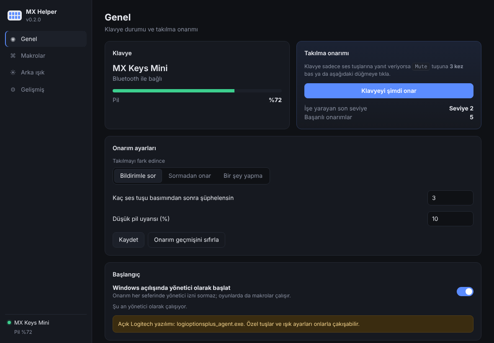
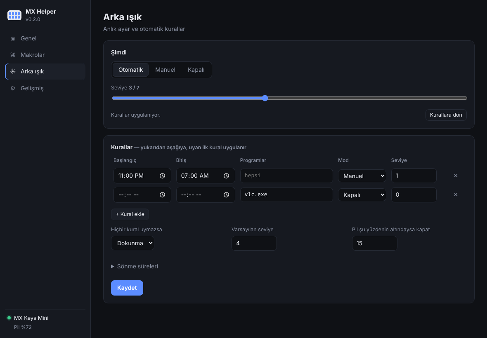

# MX Helper

**Logitech MX Keys Mini için Windows yardımcı programı.** Bluetooth bağlantısı takılınca klavyeyi kendisi onarır. Arka ışığı kurallarla yönetir. Klavye kombinasyonlarına, fare yan tuşlarına ve MX'in özel tuşlarına makro bağlamanı sağlar: turbo (basılı tuttukça bas-çek), aç/kapa döngü veya kaydedilmiş tuş dizisi.

> A small Windows tray app for the Logitech MX Keys Mini: fixes the Bluetooth "only media keys work" hang, controls the backlight over HID++, and adds hotkey / mouse-button / MX-key macros with turbo (hold-to-repeat), toggle loops and recording. No dependencies, single exe.


## Özellikler

### Takılma onarımı
Bazen klavye uykudan uyanınca Windows'un Bluetooth sürücüsü normal tuşların geldiği kanala yeniden abone olmuyor. O zaman sadece ses tuşları çalışıyor. Bu durumda:

- **Mute tuşuna 3 kez bas.** Program Bluetooth'u onarır ve bu sırada 3 kez açılıp kapanan sesi eski haline getirir.
- Program bu durumu kendisi de fark edebilir: klavyeden uzun süre bir şey gelmedikten sonra yalnızca ses tuşları gelirse bildirim gösterir. Ayarlardan, sormadan onarmasını da seçebilirsin.
- Onarım üç seviyeden oluşur:
  1. Klavyenin HID-over-GATT servisini yeniden başlatır.
  2. Bluetooth adaptörünü kapatıp açar.
  3. Bluetooth servisleri ile adaptörü birlikte sıfırlar.

  Hangi seviyenin işe yaradığını kaydeder ve bir dahaki sefere doğrudan o seviyeden başlar.

### Makrolar
| | |
|---|---|
| **Tetikleyiciler** | `ctrl+alt+k`, `f13`, `win+shift+s`… · `mouse4`, `mouse5`, `middle` · `mx:0x0108` (MX özel tuşları) |
| **Bir kez çalıştır** | Basınca eylemleri çalıştırır; istenirse N kez tekrarlar |
| **Basılı tuttukça tekrarla** | Tuş basılı kaldığı sürece eylemleri belirlediğin aralıkla tekrarlar (turbo tık, turbo tuş) |
| **Bas başlat / bas durdur** | İlk basışta döngüyü başlatır, ikinci basışta durdurur |
| **Kayıt** | Tuşlara ve fare tıklamalarına basma–bırakma sıralarını ve aradaki beklemeleri kaydeder |
| **Eylemler** | tık, fare tuşunu basılı tut/bırak, tuş kombinasyonu, tuşu basılı tut/bırak, bekle, metin yaz, program aç, URL aç, komut çalıştır, HTTP isteği, arka ışık, onarım |
| **Programa özel** | Makro sadece seçtiğin program öndeyken çalışır, diğer zamanlarda tuş normal davranır |
| **Acil durdurma** | `ctrl+alt+pause` çalışan tüm makroları durdurur |

### Arka ışık
Otomatik, manuel ya da kapalı mod seçebilirsin; manuel modda seviyeyi kaydırıcıyla ayarlarsın. Saate göre (ör. 23:00–07:00 kısık) ve programa göre (ör. VLC açıkken kapalı) kurallar yazılabilir. Pil belirlediğin yüzdenin altına inince ışık otomatik kapanır.

<p>
  
  
</p>

## Kurulum

1. [Releases](../../releases) sayfasından `MXHelper.exe`'yi indir ve istediğin bir klasöre koy.
2. Çalıştır. Simge görev çubuğunun sağ altındaki bildirim alanına yerleşir. Programı ilk açtığında ayar penceresi de kendiliğinden açılır.
3. **Genel → "Windows açılışında yönetici olarak başlat"** seçeneğini aç. Bir kerelik yönetici izni (UAC onayı) ister. Bu seçenek açıkken:
   - Onarım her seferinde yönetici izni sormaz.
   - Yönetici olarak çalışan oyunlarda da makrolar çalışır.

Simgeye sol tıklayınca ayar penceresi açılır, sağ tıklayınca hızlı menü açılır. Ayarlar ve günlükler `%APPDATA%\MXHelper\` klasöründe tutulur.

## Nasıl çalışır

- **Klavyeyle iletişim:** Logitech'in HID++ 2.0 protokolünü Bluetooth LE üzerinden kullanır (rapor `0x11`, cihaz indeksi `0xFF`). Pil için `0x1004`, arka ışık için `0x1982`, özel tuşlar için `0x1B04` özelliklerini kullanır.
- **Takılmayı algılama:** Windows'un raw input arayüzüyle hangi tuş olayının MX'ten geldiğini ayırt eder. Takılmanın belirtisi şudur: klavyeden medya tuşları geliyor ama normal tuşlar hiç gelmiyor.
- **Makro tetikleme:** Klavye ve fare kombinasyonlarını düşük seviyeli kancalarla (`WH_KEYBOARD_LL` / `WH_MOUSE_LL`) yakalar. Kancalar sadece bir makro bunları gerektirdiğinde kurulur. Programın kendi gönderdiği tuşlar işaretlidir, böylece kancalar onları tekrar yakalamaz.
- **Arayüz:** Programın içindeki bir web sunucusu yalnızca `127.0.0.1` adresinden ulaşılabilir ve rastgele bir erişim anahtarıyla korunur. Pencere Edge'in uygulama modunda açılır.
- **Bağımlılıklar:** Yalnızca Go standart kütüphanesi ve Win32 çağrıları kullanılır; cgo yoktur.

## Derleme

Go 1.24 veya daha yeni bir sürüm gerekir.

```bash
make build VERSION=v0.2.0            # Linux / macOS'tan Windows için çapraz derleme
powershell -File build.ps1 -Version v0.2.0   # Windows'ta
```

`v*` biçiminde bir etiket gönderdiğinde GitHub Actions exe'yi derleyip Release'e ekler.

## Notlar

- **Oyunlar:** Turbo ve makrolar bazı çevrim içi oyunların kurallarına aykırı olabilir; hile koruma yazılımları (anti-cheat) bu tür programlara tepki verebilir. Kullanmadan önce ilgili oyunun kurallarına bak.
- **Logitech yazılımları:** Logi Options+ ya da G HUB açıkken özel tuşlar ve arka ışık ayarları bu programla çakışabilir.
- **Desteklenen cihazlar:** Program yalnızca MX Keys Mini'de geliştirildi. Bluetooth üzerinden HID++ 2.0 konuşan başka Logitech klavyelerde de çalışabilir; `Gelişmiş → Cihaz adı içerir` alanını değiştirerek deneyebilirsin.
- Bir sorun bildirirken `Gelişmiş → Tanılama raporu` çıktısını da ekle.

Bu proje Logitech ile bağlantılı değildir. "Logitech", "MX Keys" ve "Logi Options+" Logitech'in ticari markalarıdır.

## Lisans

MIT
